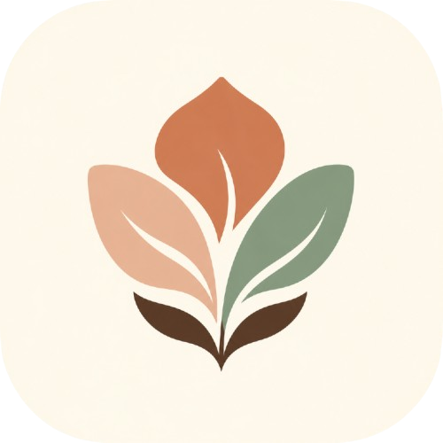

<div align="center">



# 🌸 Rasa

### Ruang aman untuk rasa

*Blog & storytelling app untuk berbagi cerita tentang patah hati, self-love, dan perjalanan diri.*

[](https://flutter.dev)
[](https://dart.dev)
[](https://supabase.com)
[](LICENSE)

</div>

---

## 📖 Tentang Rasa

**Rasa** adalah aplikasi mobile yang dibangun dengan Flutter untuk menjadi ruang aman bagi siapa pun yang ingin:

- ✍️ **Menulis** dan berbagi cerita personal
- 📖 **Membaca** cerita orang lain yang relate
- ❤️ **Berinteraksi** lewat like, bookmark, dan komentar
- 🌙 **Menikmati** pengalaman baca yang cozy dengan dark mode

> "Tak perlu sempurna. Ceritamu pantas punya ruang."

---

## ✨ Fitur

### 🔐 Autentikasi
- Register & login via Supabase Auth
- Session persistent (auto-login)
- Logout aman

### 📝 Konten
- Home feed dengan artikel terbaru
- Filter by tag: `#patahhati` `#selflove` `#relationship` `#random`
- Submit story dengan upload cover
- Edit & delete artikel sendiri
- Search artikel real-time
- Reading time otomatis

### 💬 Engagement
- ❤️ Like artikel
- 🔖 Bookmark artikel
- 💬 Komentar
- 📤 Share artikel
- 👁️ Views counter

### 👤 Profil
- Edit profil (nama, bio, username)
- Upload avatar dari galeri
- Tab: **Artikel saya** / **Disukai** / **Disimpan**
- Stats: artikel, pengikut, mengikuti

### 🎨 UI/UX
- Design system warm & cozy (cream, terracotta)
- **Dark mode** full support
- Animasi smooth
- Floating bottom nav
- Typography editorial (Playfair Display + Inter)

---

## 🎨 Design System

### Color Palette

| Warna | Hex | Penggunaan |
|-------|-----|------------|
| 🟤 Terracotta | `#C97B5A` | Primary accent |
| 🌸 Dusty Rose | `#E8B4A0` | Secondary accent |
| 🌿 Sage Green | `#8FA88F` | Tertiary accent |
| ☕ Warm Cream | `#FAF3E0` | Background (light) |
| 🟫 Deep Espresso | `#3E2C23` | Text primary |
| 🌙 Midnight | `#1A1A2E` | Background (dark) |
| 💜 Lavender | `#A084CA` | Accent (dark) |

### Typography

- **Headings**: Playfair Display (serif, editorial)
- **Body**: Inter (clean sans-serif)
- **Labels**: DM Mono (monospace)
- **Quotes**: Lora (italic serif)

---

## 🛠️ Tech Stack

| Layer | Teknologi |
|-------|-----------|
| **Framework** | Flutter 3.24+ |
| **Language** | Dart 3.5+ |
| **State Management** | Riverpod 2.6 |
| **Routing** | go_router 14.6 |
| **Backend** | Supabase (PostgreSQL + Auth + Storage) |
| **Local Storage** | shared_preferences |
| **Image Cache** | cached_network_image |
| **Image Picker** | image_picker |
| **Share** | share_plus |
| **Fonts** | google_fonts |

---

## 🚀 Getting Started

### Prerequisites

- [Flutter 3.24+](https://docs.flutter.dev/get-started/install)
- [Docker Desktop](https://www.docker.com/products/docker-desktop/)
- [Supabase CLI](https://supabase.com/docs/guides/cli)

### Instalasi

1. **Clone repo:**
   ```bash
   git clone https://github.com/MuhammadReki/rasa-app.git
   cd rasa-app